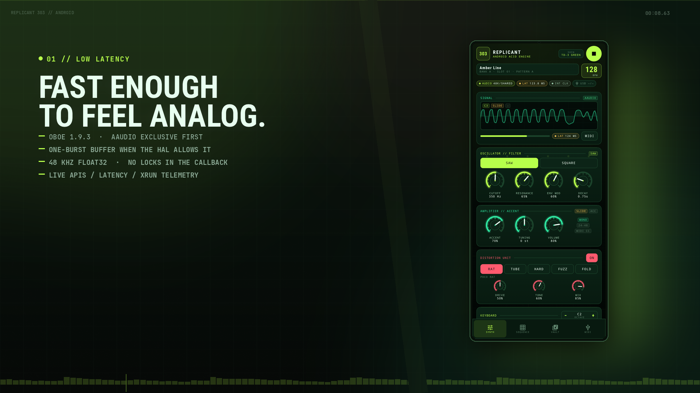
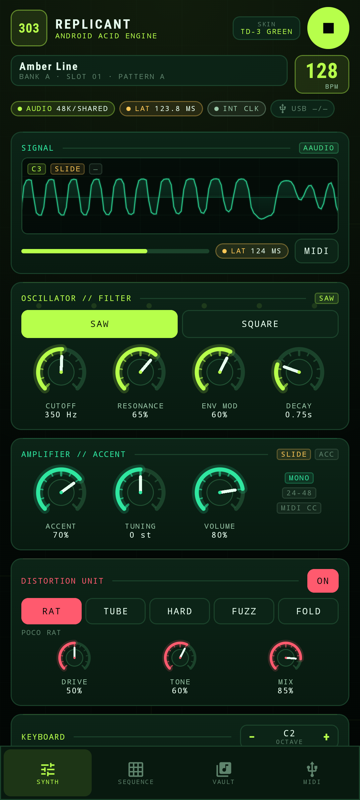
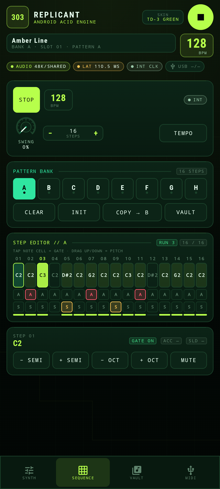
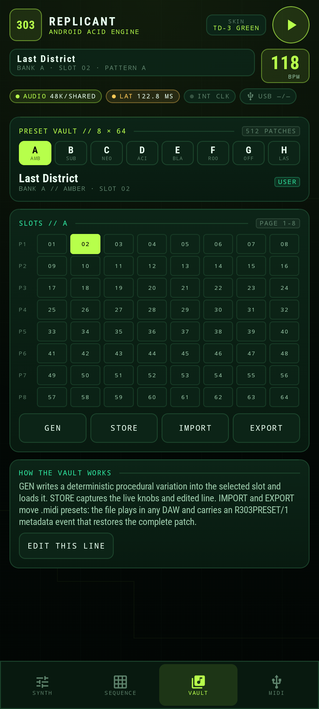
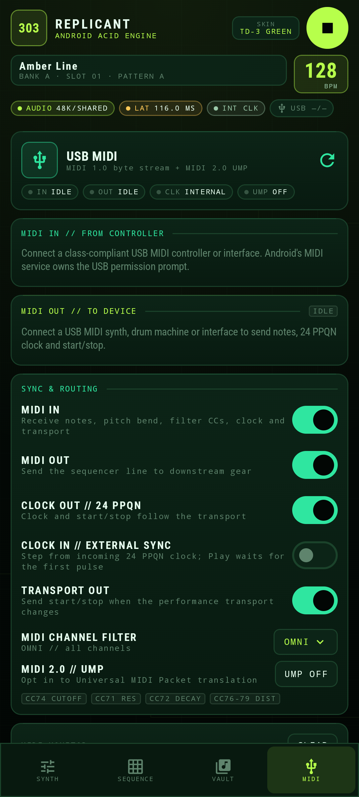
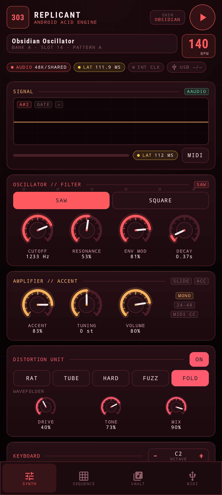
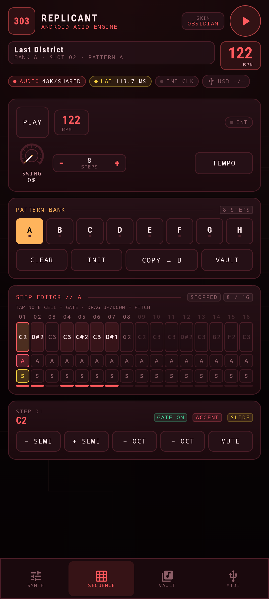
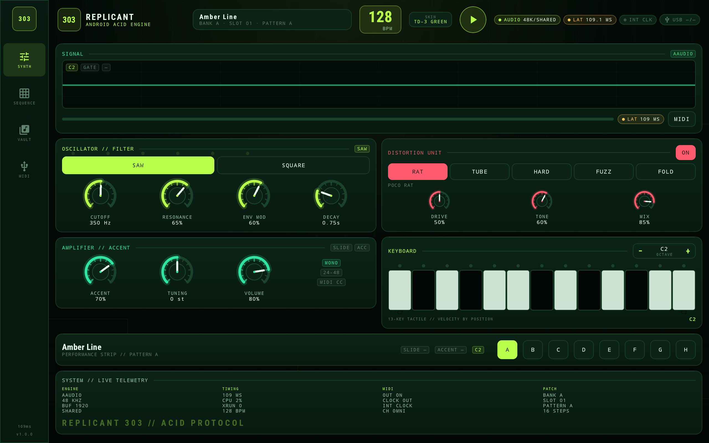

# REPLICANT 303 // ANDROID

<p align="center">
  <strong>A native Android port of Replicant303 — the TB-303 virtual-analog acid engine — rebuilt for touch, USB MIDI and low-latency audio.</strong><br>
  <em>Kotlin + Jetpack Compose · C++20 DSP · Oboe / AAudio · USB MIDI 1.0 + MIDI 2.0 · Phone + Tablet</em>
</p>

<p align="center">
  <a href="assets/replicant303_android_promo_1080p.mp4">
    
  </a>
</p>

<p align="center">
  <em>▶ Watch the 1080p promo (48 s, English) — real emulator UI, with the acid line rendered by the native engine.</em>
</p>

<p align="center">
  <a href="https://github.com/DanimanX/Replicant303Android/actions/workflows/android.yml">
    
  </a>
  <a href="https://github.com/DanimanX/Replicant303Android/releases/latest">
    
  </a>
</p>

<p align="center">
  📦 <strong><a href="https://github.com/DanimanX/Replicant303Android/releases/latest">Download the Android APK (latest release)</a></strong>
</p>

<p align="center">
  Replicant303 Android is free and open source. If it earns a place in your setup and you
  feel like saying thanks, you can buy me a coffee — completely optional.
</p>

<p align="center">
  <a href="https://paypal.me/DanimanX?locale.x=en_US&amp;country.x=CL">
    
  </a>
</p>

<p align="center">
  <sub><a href="https://paypal.me/DanimanX?locale.x=en_US&amp;country.x=CL">paypal.me/DanimanX</a></sub>
</p>

---

## Overview

**Replicant303 Android** is an Android port of [Replicant303](https://github.com/DanimanX/Replicant303),
the desktop TB-303 emulation. The original JUCE plug-in engine has been ported to a
JUCE-free C++20 core and wrapped in a modern Android application built on the
low-latency architecture of [ReplicantTr8s Android](https://github.com/DanimanX/ReplicantTr8sAndroid):

- **Kotlin + Jetpack Compose** for a responsive, touch-first acid panel.
- **Oboe 1.9.3** with an **AAudio low-latency path** (exclusive mode requested, shared fallback).
- **JNI** bridge with lock-free MIDI input/output queues, atomic parameters and a seqlock pattern snapshot.
- **USB MIDI input and output**, MIDI 2.0 UMP translation on Android 13+, 24 PPQN clock, transport sync and a live MIDI monitor.
- **Adaptive layout** for phones in portrait and tablets in portrait or landscape.
- **Two panel skins**: TD-3 Green and Obsidian Red, selectable from the header and saved with the session.
- **No proprietary content**: every pattern and preset is generated by the project's own code.

The app opens ready to play — there is no firmware gate, no account and no network
permission. On first launch the engine loads the **Amber Line** factory patch; press
PLAY and the 303 runs. Later launches restore the last session patch.

---

## Feature highlights

### Acid voice

- Band-limited PolyBLEP sawtooth and RC-droop square wave.
- 4-pole diode ladder filter with non-linear saturation, AC decoupling and self-oscillation.
- Interactive VCF/VCA envelopes, capacitor-modelled 60 ms slide and squelch accent.
- Five distortion models: **Poco Rat**, **Tube Drive**, **Hard Clip**, **Germanium Fuzz** and **Wavefolder**.
- Monophonic note stack, pitch bend (±2 semitones via MIDI) and a 13-key touch keyboard with velocity by touch position.

### Pattern core

- **8 patterns × 16 steps** with gate, note, accent and slide per step.
- Tap a note cell to toggle the gate; drag vertically to change pitch; use the
  inspector for semitone/octave edits when a drag is not convenient.
- Pattern length 1–16, swing, internal tempo and live step telemetry.
- Accents fire at velocity 110 and open the filter harder; slides hold through the
  next step for the classic 303 glide.
- Pattern copy, clear and factory init.

### Preset vault

- **8 banks × 64 slots = 512 complete presets** (pattern + voice + distortion + tempo/swing).
- Deterministic procedural **GEN** button; **STORE** captures the live edit.
- **IMPORT / EXPORT** move `.midi` presets. The file is a valid Standard MIDI File
  that plays in any DAW and carries an `R303PRESET/1` metadata event with the full patch.
- Plain MIDI files without metadata are imported as patterns: notes map to the
  16-step grid, velocity ≥ 100 becomes an accent and full-length notes become slides.
- User slots and the current session are persisted locally; no cloud.

### USB MIDI

- Enumerate class-compliant USB MIDI devices.
- Connect **MIDI IN** and **MIDI OUT** independently.
- **MIDI 2.0 UMP** translation on Android 13+ for UMP-capable devices, with MIDI 1.0 fallback.
- 24 PPQN clock out, start/stop, channel filter and a live monitor.
- MIDI clock in drives the sequencer; the UI shows `EXT WAIT` until the first pulse and
  `LOCKED` once the tempo estimate settles.

### Low latency and a clean audio callback

- AAudio exclusive mode at the device's native sample rate is attempted first (the MMAP fast path),
  then exclusive at 48 kHz, then shared AAudio, then OpenSL ES.
- One-burst buffer when exclusive mode is granted; two bursts in shared mode.
- Adaptive buffer growth after underruns, with the buffer size surfaced in the UI.
- No allocations, locks or HAL queries inside the audio callback.
- Parameter changes are atomics; step edits are published through a seqlock; MIDI uses
  single-producer/single-consumer ring buffers.
- Non-finite samples are dropped at every feedback boundary and the output has a soft safety clip.

> Latency is device-dependent. The emulator used for verification opened AAudio in
> **shared** mode with a 1920-frame buffer and reported roughly **110–125 ms**. That is
> emulator I/O, not a phone figure: the app displays the actual API, sharing mode,
> sample rate, buffer size and latency instead of promising a fixed number. On real
> hardware, exclusive AAudio is what moves the reported figure below the shared-mode floor.

---

## Screenshots

<p align="center">
  
  
  
</p>

<p align="center">
  <em>TD-3 Green: live scope and acid voice · 16-step editor with gate/accent/slide lanes · generated preset stored in the vault.</em>
</p>

<p align="center">
  
  
  
</p>

<p align="center">
  <em>USB MIDI routing and sync · Obsidian Red panel · the same engine with per-step accents and slides.</em>
</p>

<p align="center">
  
</p>

<p align="center">
  <em>Tablet landscape: two-column performance layout with live system telemetry.</em>
</p>

---

## How the 303 is put together

```
┌──────────────────────────── Android app (Kotlin + Compose) ────────────────────────────┐
│  MainActivity · Compose panels · MainViewModel · EngineController                      │
│  MidiController (USB MIDI 1.0 / MIDI 2.0 UMP) · PresetFileIO (JSON + SMF)              │
└───────────────────────────────────────┬────────────────────────────────────────────────┘
                                        │ JNI (atomics, seqlock, SPSC rings)
┌───────────────────────────────────────▼────────────────────────────────────────────────┐
│  Native C++20 core                                                                     │
│  Engine ─ Sequencer (8 × 16, clock, swing, external sync)                              │
│         └ Synth303 ─ Oscillator303 · DiodeLadderFilter · Envelope303 · DistortionUnit │
│  PresetBank (deterministic 8 × 64 generator) · AudioDriver (Oboe / AAudio)             │
└────────────────────────────────────────────────────────────────────────────────────────┘
```

- **Audio thread:** sequencer tick → synth → safety clip → stereo float output; MIDI
  clock/transport and note events are timestamped against the audio clock.
- **UI thread:** parameter atomics, pattern edits through a seqlock, live keyboard and
  MIDI queues.
- **Persistence:** `SharedPreferences` stores the session patch, selected bank/slot,
  user vault overrides and UI skin.

Read [docs/ARCHITECTURE.md](docs/ARCHITECTURE.md) for the threading and data-flow details.

---

## Downloads & installation

Download the latest APK from [Releases](https://github.com/DanimanX/Replicant303Android/releases).
The APK is built for `arm64-v8a` and `x86_64`, `minSdk 26`, `targetSdk 35`.

```bash
adb install -r Replicant303Android-1.0.0.apk
```

The app asks for notification permission so the foreground audio service can show
its transport notification. It does not request network, storage or location access.

---

## Building from source

### Android app

Requirements: **JDK 17**, **Android SDK 35**, **NDK 27.0.12077973**, **CMake 3.22.1**.

```bash
git clone https://github.com/DanimanX/Replicant303Android.git
cd Replicant303Android

# Point Gradle at your SDK (or create local.properties)
echo "sdk.dir=$HOME/android-sdk" > local.properties

JAVA_HOME=/path/to/jdk17 ./gradlew :app:assembleDebug
JAVA_HOME=/path/to/jdk17 ./gradlew :app:assembleRelease
JAVA_HOME=/path/to/jdk17 ./gradlew :app:testDebugUnitTest
```

Release signing can be supplied through `REPLICANT_KEYSTORE`,
`REPLICANT_KEYSTORE_PASSWORD`, `REPLICANT_KEY_ALIAS` and `REPLICANT_KEY_PASSWORD`.
Without them, the release build falls back to the debug key so it always installs.

### Host tests and soundtrack renderer

The DSP core has no Android dependency, so the sequencer, preset vault and signal
path can be tested on the host:

```bash
cmake -S tools/host -B build-host -DCMAKE_BUILD_TYPE=Release
cmake --build build-host -j
./build-host/r303_tests
./build-host/render_demo assets/replicant303_android_demo.wav 48 132
```

The host suite currently runs **206 checks** covering the factory patterns, clock,
swing, accent/slide, external clock, preset generation and wire round-trips, engine
preset loading, MIDI clock output, CC control and DSP stability at extreme settings.

### Promotional video

```bash
python3 tools/make_promo.py
```

The script uses the emulator screenshots in `screenshots/`, the engine-rendered
`assets/replicant303_android_demo.wav`, and a procedural drum/pad bed. It writes
`assets/replicant303_android_promo_1080p.mp4` and `assets/replicant303_android_poster.png`.

---

## MIDI implementation

### MIDI IN

| Message | Effect |
|---|---|
| Note On / Note Off | Plays the voice; velocity ≥ 100 accents the note |
| Pitch Bend | ±2 semitones |
| CC 74 | Filter cutoff (logarithmic, 25 Hz – 4.5 kHz) |
| CC 71 | Resonance |
| CC 72 | Decay (0.20 – 2.50 s) |
| CC 73 / CC 1 | Env mod |
| CC 75 | Accent amount |
| CC 76 / 77 / 78 | Distortion drive / tone / mix |
| CC 79 | Distortion on (≥ 64) / off |
| CC 80 | Waveform square (≥ 64) / saw |
| CC 120 / 123 | All sound off / all notes off |
| Clock (0xF8) | Steps the sequencer when **CLOCK IN** is enabled |
| Start / Stop (0xFA / 0xFC) | Transport when **CLOCK IN** is enabled |

The channel filter can be set to OMNI or channels 1–16. Incoming clock is used for
tempo estimation and step timing; the UI reports `EXT WAIT` / `LOCKED`.

### MIDI OUT

- Sequencer note on/off with velocity 80 or 110.
- 24 PPQN clock while the transport runs (can be disabled independently).
- Start/stop when **TRANSPORT OUT** is enabled.
- Channel follows the MIDI channel filter (OMNI → channel 1).

Read [docs/MIDI_USB.md](docs/MIDI_USB.md) for the USB permission flow and UMP details.

---

## Preset files

A `.midi` preset is a Standard MIDI File at 960 PPQ with:

- a track-name text event,
- a `Text` meta event `R303PRESET/1:{...}` containing the complete patch as JSON,
- a tempo event,
- 16th-note note events (accent = velocity 110, slide = full 16th length).

The JSON stores the waveform, tuning, cutoff, resonance, env mod, decay, accent,
tempo, swing, distortion model/drive/tone/mix and all 16 steps. Import accepts both
this format and plain MIDI patterns.

---

## CI/CD

`.github/workflows/android.yml` runs on every push and tag:

- host build + 206-check regression suite,
- Android debug and release APK builds (`arm64-v8a`, `x86_64`),
- unit tests for the MIDI parser, UMP codec and preset file codec,
- on a version tag, uploads the signed release APK and attaches it to the GitHub release.

---

## Privacy

No network permission. No analytics. No accounts. MIDI and audio stay on the device;
preset import/export only touches the file the user picks in the system picker.

---

## Credits

- Original **Replicant303** DSP, sequencer, preset generator and design: DanimanX.
- **ReplicantTr8s Android** low-latency audio-driver and USB MIDI architecture: DanimanX.
- [Oboe](https://github.com/google/oboe) by Google — Apache 2.0.
- [Jetpack Compose](https://developer.android.com/jetpack/compose) — Apache 2.0.
- Roboto Condensed — Apache 2.0.

TB-303 and Roland are trademarks of Roland Corporation. This project is not
affiliated with or endorsed by Roland. No Roland samples, firmware or factory
tables are included.

---

## License

MIT License. See [LICENSE](LICENSE) and [NOTICE](NOTICE).
